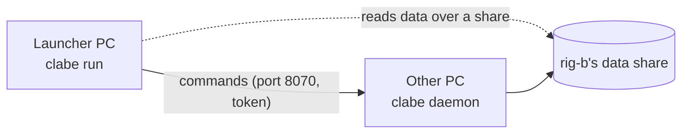

# Run on two PCs

Drive an app on a second rig PC (e.g. ephys) from the launcher on the first, and collect both machines' data.



The full script is in the [remote execution example](../docs_examples/remote_execution.md).

## 1. Install the daemon on the other PC

- Install it once per rig PC: see [Deploy a rig](deployment.md).
- List **this repository's** checkout under `repositories`; commands run there, in its `.venv`.

```yaml
# %PROGRAMDATA%\clabe.yml on rig-b
daemon:
  host: 0.0.0.0
  repositories:
    - path: C:/git/Aind.Experiment.VrForaging
  max_jobs: 4                    # commands running at the same time
  max_file_size: 52428800        # largest file transferred (50 MB)
  file_transfer_dir: D:/clabe-transfer
  lease_grace: 300               # seconds a crashed run can take the machine back
```

!!! warning "The token is the only protection"
    The daemon runs **any command** it is given, as its user. Keep the token (`CLABE_TOKEN`) out of the repository
    and bind `0.0.0.0` only on the rig network.

## 2. Connect from the launcher

Put the same token in the launcher's `clabe.yml`:

```yaml
worker_client:
  token: "<the same secret>"
  # url: http://rig-b:8070       # only if you build WorkerClientSettings() yourself
  # repository: Aind.Experiment.VrForaging   # default: this repository's folder name
```

```python
from clabe.remote import RemoteRepository
from clabe.utils import is_this_computer

remote = RemoteRepository.from_computer_name("rig-b", data_roots={r"D:\data": r"\\rig-b\data"})
remote.ensure_running()  # pings the daemon; starts its task if it is down
remote.verify()          # same origin, commit, submodules, and no uncommitted changes there
```

| Argument | Meaning |
| --- | --- |
| `path` | Repository path on that machine (default: the daemon's repository). |
| `repository` | The daemon's name for the checkout (default: this repository's folder name). |
| `local_path` | Local repository to compare with (default: `.`). |
| `data_roots` | Maps data folders there to the share that exposes them. Others use the admin share (`\\rig-b\D$\...`). |
| `detach_on_abort` | Keep remote commands running when the run aborts ([`RemoteRepository`][clabe.remote.RemoteRepository] constructor only). |

- `ensure_running()` needs admin rights on that PC to start its task (`schtasks /run /s <host>`).
- `verify(allow_dirty=True)` accepts uncommitted changes there.
- `is_this_computer(rig.computer_name)` tells you whether to run a rig's app locally instead.

## 3. Run an app there

Build the app as usual, then pass `executor=remote`:

```python
from clabe.workflow import concurrently

ephys_app = AindBehaviorServicesBonsaiApp(
    workflow=Path("./Aind.Physiology.Fip/src/main.bonsai"),
    executable=Path("./Aind.Physiology.Fip/.bonsai/bonsai.exe"),
    temp_directory=launcher.temp_dir,
    rig=fip_rig,
    session=session,
)
results = await concurrently(
    behavior=lambda: behavior_app.run_async(),
    ephys=lambda: ephys_app.run_async(executor=remote),
)
```

- The first command **leases** the machine: other runs get `423` until this run ends.
- Paths inside the local repository (also in `-p:Name=<path>`) are rewritten to the remote one. Other paths are sent as is.
- Files in [`Command.inputs`][clabe.apps.Command] (rig, session, task JSON) are copied there and deleted when the command exits.
- Output streams live into the run's UI; aborting the run stops the command there.
- `run.json` records each machine (`workers`) and each command it ran.
- The launcher must pass the app's validation (e.g. `.bonsai/`), or pass `skip_validation=True` to the app.

To run a command without an app, use the [`WorkerClient`][clabe.remote.WorkerClient]:

```python
result = remote.client.run_command(["python", "--version"])  # waits
job = remote.client.submit_command(["python", "slow.py"])     # poll with get_result(job.job_id)
remote.client.upload_model(session, "session.json")           # up to max_file_size
```

## 4. Give it a session folder

```python
remote.register_session(session, r"D:\data")  # creates D:\data\<session name> on rig-b
```

| Property | Example | Use on |
| --- | --- | --- |
| `remote.session_directory` | `D:\data\<session>` | The **other PC**: app properties, output folders. |
| `remote.session_directory_unc` | `\\rig-b\data\<session>` | The **launcher**: watchdog, data mappers. |
| `remote.data_directory` | `D:\data` | The root, as that PC sees it. |

- These are `PureWindowsPath`s; wrap in `Path(...)` where needed.
- `remote.to_unc(path)` translates any path; `clabe.remote.to_unc(path, data_roots, host=...)` works without a daemon.
- Run heavy processing on the PC that has the data (`executor=remote`), not over the share.

## 5. Upload both machines' data

```python
watchdog = WatchdogDataTransferService(
    source=[launcher.session_directory, remote.session_directory_unc],
    settings=WatchdogSettings(destination=..., project_name=...),
    session=session,
)
watchdog.transfer()
```

- One manifest covers both; modality folders with the same name are merged.
- Every source must be reachable, or `transfer()` fails and lists them all.
- The watchdog copies later, as its own account: that account needs the share, and the PC must be on.
- To upload the other PC's modalities as a separate job, see [Uploading data with the watchdog](data_transfer.md).

## 6. Recover after a crash

Remote jobs keep running if the launcher dies. Reattach with the crashed run's id (from its `run.json`) within
`lease_grace`:

```python
remote = RemoteRepository.from_computer_name("rig-b")
for job in remote.reattach(crashed_run_id):
    result = remote.wait_for(job.job_id)  # or await remote.wait_for_async(...)
```

## Troubleshooting

| Symptom | Fix |
| --- | --- |
| `401` | `worker_client.token` differs from the daemon's `CLABE_TOKEN`. |
| `423 In use by ...` | Another run holds the lease; it frees when that run ends (or a minute after a crash). |
| `404 No repository named ...` | Add the checkout under `daemon: repositories:` there, or set `worker_client.repository`. |
| `ConnectionError` from `ensure_running()` | The computer name does not resolve (typo, other network). |
| `ensure_running()` times out | Daemon not installed, user not logged on, or remote task scheduling blocked. |
| `verify()` lists commits | Update the other checkout and `uv sync`. |
| A windowed app shows nothing | The daemon runs as a service instead of its logon task. |
| `Watchdog source directories not found or not reachable` | Share not readable by the watchdog's account, or the PC is off. |
| A `session_directory` path fails on the launcher | Use `session_directory_unc`. |
