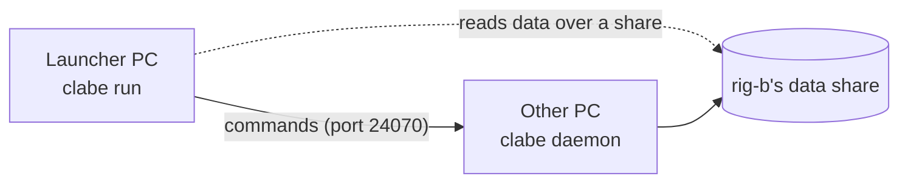

# Run on two PCs

Drive an app on a second rig PC (e.g. ephys) from the launcher on the first PC, and collect the data of both machines.



The full script is in the [remote execution example](../docs_examples/remote_execution.md).

## 1. Install the daemon on the other PC

- Install it once per rig PC: see [Deploy a rig](deployment.md).
- Clone this repository on rig-b as well, under `C:/git`. The daemon finds it there (see
  [Repositories](daemon.md#repositories)), and commands run in that checkout's `.venv`.

!!! warning "The daemon runs any command it is given"
    Keep it on the rig network. A token (`DAEMON_CLABE_TOKEN` on the daemon, `worker_client: token:` in the
    experiment) is optional. When it is set, both values must match.

## 2. Connect from the experiment

No configuration is needed. Connect by computer name:

```python
from clabe.remote import RemoteRepository
from clabe.utils import is_this_computer

remote = RemoteRepository.from_computer_name("rig-b")
remote.ensure_running()  # pings the daemon; starts its task if it is down
remote.verify()  # checks the other checkout: same origin, commit and submodules, no uncommitted changes
```

| Argument | Meaning |
| --- | --- |
| `path` | Repository path on that machine (default: the daemon's repository). |
| `repository` | The daemon's name for the checkout (default: this repository's folder name). |
| `local_path` | Local repository to compare with (default: `.`). |
| `data_roots` | Optional. Maps data folders there to the share that exposes them, overriding what the daemon reports (see [step 4](#4-give-it-a-session-folder)). |
| `detach_on_abort` | Keep remote commands running when the run aborts ([`RemoteRepository`][clabe.remote.RemoteRepository] constructor only). |

- As a step: `wf.step(steps.remote(lambda ephys_rig: ephys_rig.computer_name))` does the three lines above and
  outputs the `RemoteRepository` as `remote`, or `None` when the rig's computer is this one. It takes
  `allow_dirty=`, `repository=` and `data_roots=`.
- `ensure_running()` needs admin rights on that PC to start its task (`schtasks /run /s <host>`).
- `verify(allow_dirty=True)` accepts uncommitted changes on the other PC.
- `is_this_computer(rig.computer_name)` tells you whether to run a rig's app locally instead.
- The experiment's `clabe.yml` can set an optional `worker_client:` section (`token`, `timeout`, `lease_ttl`, and
  more).

## 3. Run an app there

Build the app as usual, then pass `executor=remote`. Here FIP runs on rig-b while behavior runs here:

```python
from clabe.workflow import concurrently

fip_app = AindBehaviorServicesBonsaiApp(
    workflow=Path("./Aind.Physiology.Fip/src/main.bonsai"),
    executable=Path("./Aind.Physiology.Fip/.bonsai/bonsai.exe"),
    temp_directory=launcher.temp_dir,
    rig=fip_rig,
    session=session,
)
results = await concurrently(
    behavior=lambda: behavior_app.run_async(),
    fip=lambda: fip_app.run_async(executor=remote),
)
```

A recording that lasts as long as the session, such as Open Ephys, is not a branch: wrap the branches in it. It
starts before them and stops once they have all ended, also on failure or abort:

```python
from contextlib import asynccontextmanager

from clabe.apps.open_ephys import OpenEphysApp, OpenEphysAppSettings

open_ephys = OpenEphysApp(OpenEphysAppSettings(signal_chain="./signal_chain.xml"))


@asynccontextmanager
async def recording():
    await open_ephys.launch(executor=remote)  # opens the GUI on rig-b; the client talks to rig-b's port
    try:
        open_ephys.start()
        yield
    finally:
        open_ephys.stop()
        await open_ephys.close()


async with recording():
    results = await concurrently(behavior=lambda: behavior_app.run_async(), fip=lambda: fip_app.run_async())
```

- The first command leases the machine. Other runs get `423` until this run ends.
- Paths inside the local repository (also in `-p:Name=<path>`) are rewritten to the remote repository. Other paths
  are sent unchanged.
- Files in [`Command.inputs`][clabe.apps.Command] (rig, session, task JSON) are copied to the other PC and deleted
  when the command exits.
- The command's output streams live into the run's UI. Aborting the run stops the command on the other PC.
- `run.json` records each machine (`workers`) and each command it ran.
- The launcher PC must pass the app's validation (e.g. `.bonsai/`). Otherwise, pass `skip_validation=True` to the app.

To run a command without an app, use the [`WorkerClient`][clabe.remote.WorkerClient]:

```python
result = remote.client.run_command(["python", "--version"])  # waits for the result
job = remote.client.submit_command(["python", "slow.py"])  # returns at once; poll with get_result(job.job_id)
remote.client.upload_model(session, "session.json")  # up to max_file_size
```

## 4. Give it a session folder

```python
remote.register_session(session, ephys_rig.data_directory)  # e.g. D:\data on rig-b: creates D:\data\<session name>
```

Take the data folder from the rig configuration of the app that runs there. The run records the folder (in
`run.json`, under `workers`), so `launcher.session_directories` lists it (step 5).

| Property | Example | Use on |
| --- | --- | --- |
| `remote.session_directory` | `D:\data\<session>` | The **other PC**: app properties, output folders. |
| `remote.session_directory_unc` | `\\rig-b\data\<session>` | The **launcher**: watchdog, data mappers. |
| `remote.data_directory` | `D:\data` | The root, as that PC sees it. |

- These are `PureWindowsPath`s. Wrap them in `Path(...)` where needed.
- `remote.to_unc(path)` translates any path to its network path. It uses, in order: `data_roots` when given; the
  folders rig-b shares (its daemon lists them: `D:\data` shared as `data` gives `\\rig-b\data`); otherwise the
  drive's administrative share (`\\rig-b\D$\...`), which needs administrator rights on rig-b.
- `clabe.remote.to_unc(path, data_roots, host=...)` translates without a daemon.
- Run heavy processing on the PC that holds the data (`executor=remote`) instead of over the share.

## 5. Upload both machines' data

```python
watchdog = WatchdogDataTransferService(
    source=launcher.session_directories,  # this PC's session folder, then every other PC's over its share
    settings=WatchdogSettings(destination=..., project_name=...),
    session=session,
)
watchdog.transfer()
```

- `launcher.session_directories` lists this PC's session folder, then this PC's other folders, then every other PC
  whose session was registered with `remote.register_session` in this run. A list written by hand works too: `None`
  entries are skipped, e.g. a PC an optional step did not use.
- An app on this PC that records to its own data folder (e.g. Open Ephys to `D:\ephys`) adds it with
  `launcher.add_session_directory(Path(rig.data_directory) / session.session_name)`. The folder is created if
  missing, and an existing one is fine (e.g. found after a crash). It is recorded in `run.json`.
- One manifest covers both machines. Modality folders with the same name are merged.
- Every source must be reachable. Otherwise `transfer()` fails and lists the unreachable sources.
- The watchdog copies the data later, under its own account. That account needs access to the share, and the PC must
  be on.
- To upload the other PC's modalities as a separate job, see [Uploading data with the watchdog](data_transfer.md).

## 6. Recover after a crash

Remote jobs keep running if the launcher crashes. Reattach with the crashed run's id (from its `run.json`) within
`lease_grace`:

```python
remote = RemoteRepository.from_computer_name("rig-b")
for job in remote.reattach(crashed_run_id):
    result = remote.wait_for(job.job_id)  # or await remote.wait_for_async(...)
```

## Troubleshooting

| Symptom | Fix |
| --- | --- |
| `401` | `worker_client.token` differs from the daemon's `DAEMON_CLABE_TOKEN`. |
| `423 In use by ...` | Another run holds the lease; it frees when that run ends (or a minute after a crash). |
| `404 No repository named ...` | Clone it under a root there (default `C:/git`), or list it in `DAEMON_CLABE_REPOSITORIES`; or set `worker_client.repository`. |
| `ConnectionError` from `ensure_running()` | The computer name does not resolve (typo, other network). |
| `ensure_running()` times out | Daemon not installed, user not logged on, or remote task scheduling blocked. |
| `verify()` lists commits | Update the other checkout and `uv sync`. |
| A windowed app shows nothing | The daemon runs as a service instead of its logon task. |
| `Watchdog source directories not found or not reachable` | Share not readable by the watchdog's account, or the PC is off. |
| A `session_directory` path fails on the launcher | Use `session_directory_unc`. |
