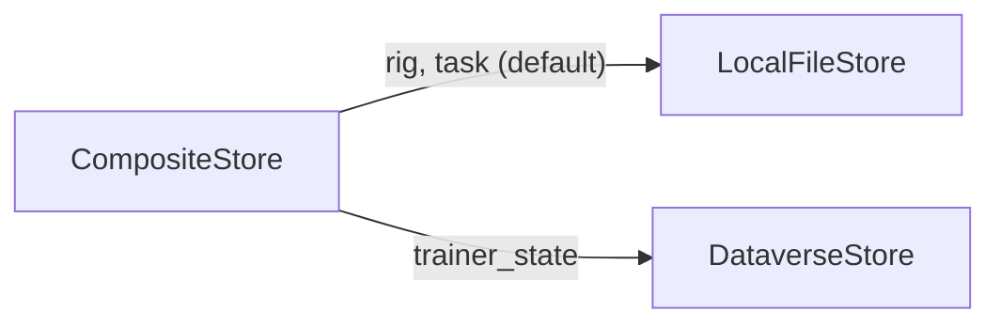

# Store Backends

Every store backend clabe ships, and how to combine them. See [Stores](stores.md) for `Kind` and the store methods.

| Backend | Serves | Prompts | Extra |
| --- | --- | --- | --- |
| [`LocalFileStore`][clabe.stores.LocalFileStore] | any kind | Pick list over files | — |
| [`MemoryStore`][clabe.stores.MemoryStore] | any kind | Pick list over records | — |
| [`DataverseStore`][clabe.aind.dataverse.DataverseStore] | `trainer_state` only | Pick list over recent suggestions | `aind-services` |
| [`ConfiergeStore`][clabe.aind.confierge.ConfiergeStore] | one ficus namespace | Never | `aind-services` |
| [`CompositeStore`][clabe.stores.CompositeStore] | whatever it routes | The routed backend's | — |



## CompositeStore: routing by kind

```python
from clabe.stores import CompositeStore, Kind, LocalFileStore
from clabe.aind.dataverse import DataverseStore

RIG = Kind.from_rig(MyRigModel)
SUGGESTION = Kind.from_trainer_state()

store = CompositeStore(
    default=LocalFileStore(root=r"\\allen\aind\scratch\AindBehavior.db\MyProject"),
    routes={"trainer_state": DataverseStore()},
)

rig = store.resolve(RIG)  # LocalFileStore (default)
trainer_state = store.resolve(SUGGESTION)  # DataverseStore (routed by kind name)
store = store.scoped(subject="789012")  # narrows every backend
```

- Routes are keyed by kind name (`"rig"`, `"task"`, `"trainer_state"`, …).
- A kind with no route and no `default` raises `LookupError`.

## LocalFileStore

A directory of JSON files. Writes overwrite existing files and create missing folders.

```python
from clabe.stores import Kind, LocalFileStore

store = LocalFileStore(root=r"\\allen\aind\scratch\AindBehavior.db\MyProject")
rig = store.resolve(Kind.from_rig(MyRigModel))
store.scope  # {"computer_name": "RIG-01"}, filled in from this machine
```

Default layout ([`DefaultLayout`][clabe.stores.DefaultLayout]):

```text
<root>/
  Rig/<computer_name>/*.json
  Task/*.json
  Subjects/<subject>/task.json
  Subjects/<subject>/<kind>.json     # trainer_state and other per-animal records
```

- `task` reads `Subjects/<subject>/task.json` first, then `Task/*.json`.
- Other kinds with no subject in scope live at the root (`<kind>.json`).

### A custom layout

Implement a [`Layout`][clabe.stores.Layout]: `read` returns glob patterns (highest priority first), `write` returns one path.

```python
from collections.abc import Sequence
from clabe.stores import LocalFileStore, Scope


class FlatLayout:
    def read(self, kind_name: str, scope: Scope) -> Sequence[str]:
        return [f"{kind_name}.json"]

    def write(self, kind_name: str, scope: Scope) -> str:
        return f"{kind_name}.json"


store = LocalFileStore(root="./my_lib", layout=FlatLayout())
```

## MemoryStore

Records in memory, for tests and in-process use. Writes append.

```python
from clabe.stores import Kind, MemoryStore

MANIPULATOR = Kind(ManipulatorPosition)

store = MemoryStore()
store.write(MANIPULATOR, ManipulatorPosition(x=0, y=0, z=0), scope={"subject": "123"})

store.list(MANIPULATOR)  # [] (no subject in scope)
store.scoped(subject="123").list(MANIPULATOR)  # [ManipulatorPosition(x=0, y=0, z=0)]
```

- A record written under a scope is only visible to reads with that scope. An unscoped record is visible to every
  read.

## DataverseStore

Trainer-state suggestions from Dataverse. Any other kind raises `LookupError`.

```bash
uv add "aind-clabe[aind-services]"
```

```python
from clabe.stores import Kind
from clabe.aind.dataverse import DataverseStore

SUGGESTION = Kind.from_trainer_state()

store = DataverseStore(history=5).scoped(subject="789012", task_name="MyTask")
trainer_state = store.resolve(SUGGESTION)
store.write(SUGGESTION, next_trainer_state)
```

- `subject` and `task_name` must be in scope.
- With `history=1` (the default), the store uses the latest suggestion without asking. A higher value offers a pick
  list.
- `tenant_id`, `client_id` and `org` come from the `dataverse` section of `clabe.yml`. The username and password come
  from KeePass (entry `svc_sipe`).

```yaml
dataverse:
  tenant_id: "..."
  client_id: "..."
  org: "your-org"
```

## ConfiergeStore

Reads and writes [ficus](https://github.com/AllenNeuralDynamics/ficus), which merges per-computer and per-subject overrides server-side.

```python
from clabe.stores import Kind
from clabe.aind.confierge import ConfiergeSettings, ConfiergeStore

RIG = Kind.from_rig(AindVrForagingRig)

store = ConfiergeStore(ConfiergeSettings(namespace="aind-behavior-vr-foraging"))
rig = store.resolve(RIG)
rig = store.scoped(subject="789907").resolve(RIG)  # with the subject's overrides
store.scoped(subject="789907").write(RIG, rig)
```

- It never prompts, because ficus returns one merged document. When ficus is unreachable, confierge serves its
  cached copy.
- Each store serves one namespace for every kind. To use several namespaces, route them with `CompositeStore`.
- Records must serialize to a JSON object.

Settings (`confierge` section of `clabe.yml`):

| Field | Default | Meaning |
| --- | --- | --- |
| `namespace` | required | The ficus namespace |
| `base_url` | `None` | Ficus URL; else `$FICUS_BASE_URL`, else confierge's default |
| `mode` | `None` | Ficus mode |
| `overwrite_defaults` | `false` | Writes may overwrite the `defaults` layer |
| `create_if_missing` | `true` | Writes may create a missing layer |
| `append_new_fields_to_last_scope` | `true` | New fields go to the most specific scope |

Scope keys map to ficus scopes through [`DEFAULT_SCOPE_MAPPING`][clabe.aind.confierge.DEFAULT_SCOPE_MAPPING]:

| Store scope | Ficus scope |
| --- | --- |
| `computer_name` (this machine's name, filled in) | `hostname` |
| `subject` | `subject_id` |

- Other keys (e.g. `task_name`) are not sent.
- Add a scope: `ConfiergeStore(settings, scope_mapping={**DEFAULT_SCOPE_MAPPING, "rig": "rig_id"})`.

## Recipes

### Per-animal settings with ByAnimalModifier

[`ByAnimalModifier`][clabe.aind.modifiers.ByAnimalModifier] reads and writes per-animal state through any store.

```python
from clabe.aind.modifiers import ByAnimalModifier
from clabe.stores import Kind

MANIPULATOR = Kind(ManipulatorPosition)


class ManipulatorModifier(ByAnimalModifier[MyRig]):
    def __init__(self, subject, store):
        super().__init__(subject, store, MANIPULATOR, "manipulator.position")

    def _process_before_update(self):
        return read_position_from_hardware()


modifier = ManipulatorModifier(session.subject, store)
rig = modifier.inject(rig)  # a copy, with the stored position; the rig passed in is never modified
...
modifier.update()
```

### Load a past session

```python
from clabe.stores import Kind, LocalFileStore

session = LocalFileStore(root=session_directory).resolve(Kind.from_session())
```

### Test against a store

```python
from clabe.stores import Kind, MemoryStore

MANIPULATOR = Kind(ManipulatorPosition)


def test_inject_uses_the_stored_record():
    store = MemoryStore()
    store.write(MANIPULATOR, ManipulatorPosition(x=1, y=2, z=3), scope={"subject": "123"})

    rig = ManipulatorModifier("123", store).inject(MyRig())

    assert rig.manipulator.position == ManipulatorPosition(x=1, y=2, z=3)
```

To test `resolve` with several candidates, bind a session that can answer:

```python
from clabe import ui

with ui.bind(ui.ClientSession(fake_client)):
    rig = store.resolve(RIG)
```
