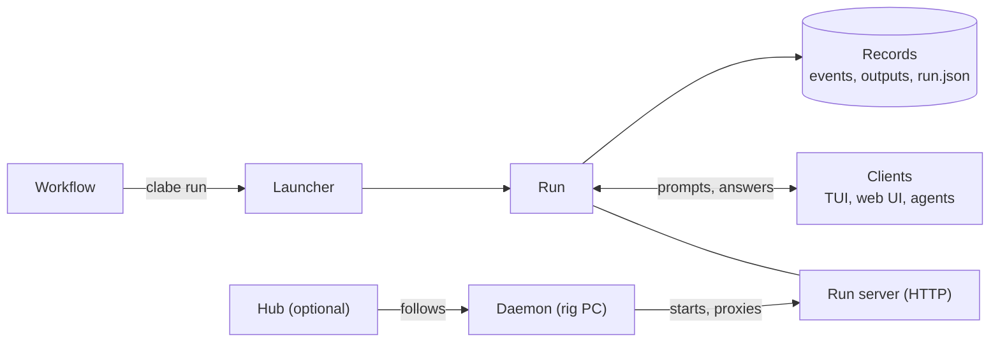
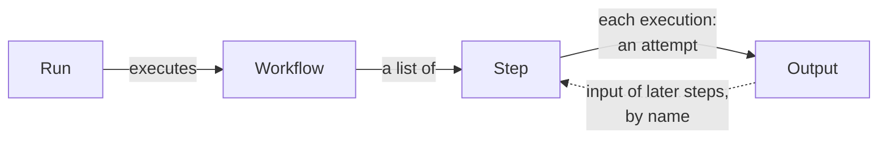
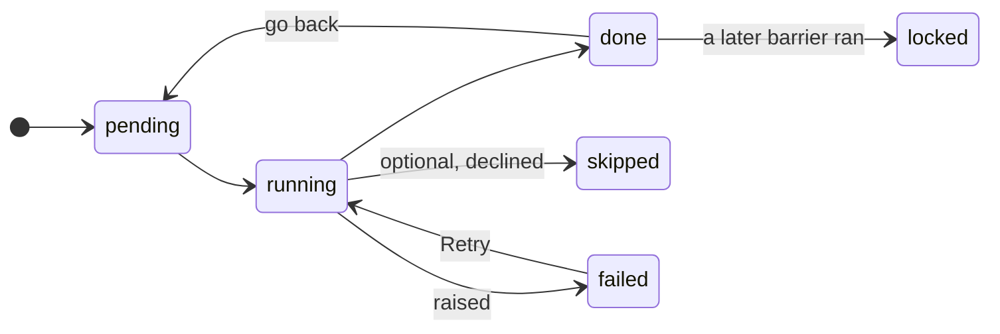
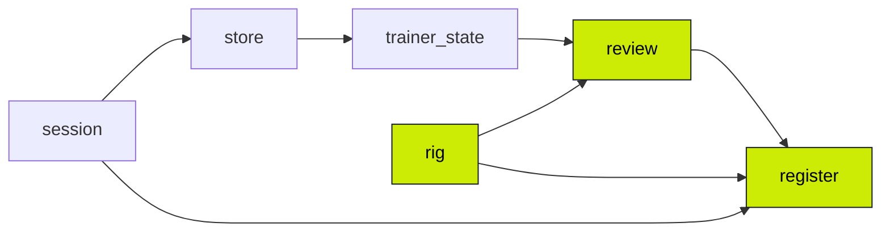
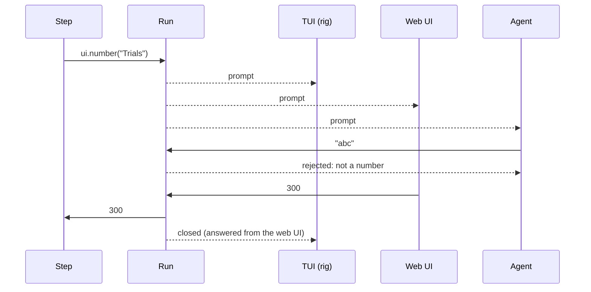
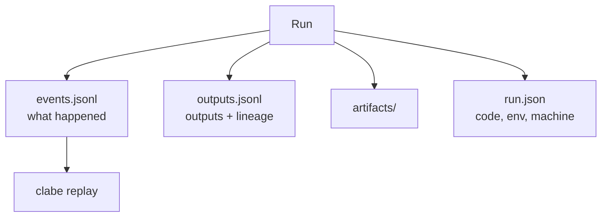
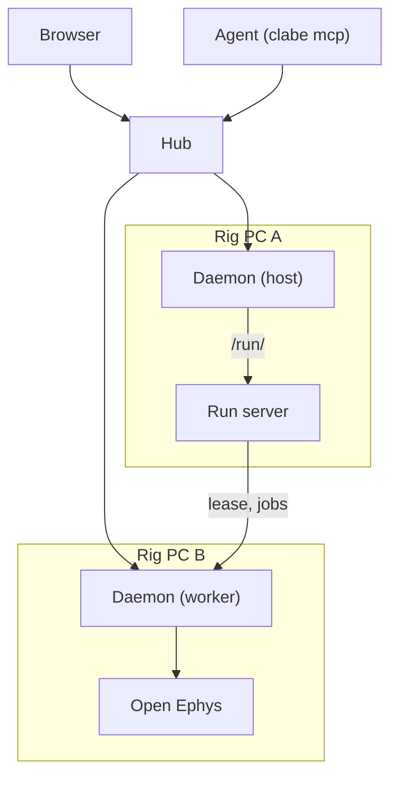

# Concepts

How clabe's pieces relate, in pictures. Terms are defined in the [glossary](glossary.md).

## How it fits together

## Steps and runs

- A step's **name** is its output's name; its **parameters** name the outputs it needs.
- Built-ins every step can take: `launcher`, `run`.

A step's states:

Going back to `rig` re-runs only what depends on it (highlighted):

## Prompts and clients

Every client sees every prompt; the run validates; the first valid answer wins.

## Records

## Machines

- Connections go from the observer to the rig, never the other way.
- A worker serves one run at a time (its **lease**).
