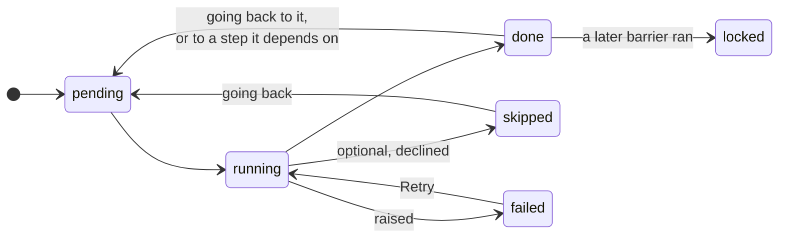
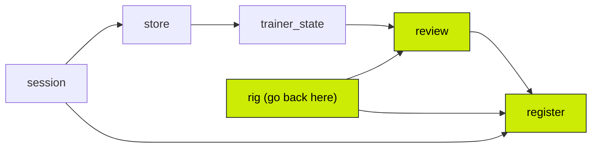

# Runs

A **run** is one execution of a workflow. It owns the session's progress: which step is running, what each step
returned, which prompt is open, and the log of everything that happened. The launcher creates one run per session
(`Launcher.run_experiment`); clients observe and drive it.

## Statuses

A run is `created`, then `running`, and ends `completed`, `aborted` (someone aborted it, or a step raised `Abort`) or
`failed` (a step failed and the user chose to abort, or the run could not continue). The launcher exits with 0 only
when the run completed.

Each step is `pending`, `running`, `done`, `skipped` (optional and declined) or `failed`, and **locked** once a later
barrier has run.

## Attempts

Steps can run more than once — after going back, or when retried — and each execution is an **attempt** (1, 2, ...).
Attempts are recorded separately: every attempt's output, the attempts of the inputs it consumed, and the artifacts
it exported. A later attempt replaces the output that later steps see; the earlier one stays on record.

## Going back

Going back to step X (clicking it, `raise GoBack("x")` from a step, `run.go_back("x")`, an agent's `go_back`) re-runs
X and every step that depends on it, directly or transitively, in order. Steps that do not depend on X keep their
outputs: going back to `rig` does not ask for the session again. Going back cancels the open prompt; a busy step is
only interrupted if it is async and `cancellable`.

Going back to `rig` re-runs the highlighted steps; `session`, `store` and `trainer_state` keep their outputs.

This is the main reason to declare steps with their inputs: the run knows the dependency graph, so "go back" means
"change this answer" rather than "start over".

## Barriers and undo

Some steps change the world: they create the session folder, start acquisition, deliver water. A **barrier** step
locks itself and everything before it once it has run; going back to a locked step is refused. A step whose effect
can be reverted declares `undo` instead, called with its output when it is invalidated.

## Failures

When a step raises, the run does not end: it pauses with **Retry / Go back / Abort**, shown to every client. Retry
runs the step again (a new attempt), Go back goes back to the previous step that can run, Abort ends the run. A step
declared `on_error="warn"` only warns and continues with `None`. To stop the run on purpose, raise `Abort("reason")`.

## Concurrency: branches

Steps run one at a time; that keeps one current step, one open prompt and simple going back. When a step must drive
several things at once — Bonsai and Open Ephys — it runs them as **branches** with `concurrently(...)`. Branches
fail independently: a failed branch pauses with *Retry it / Continue without it / Stop all* while the others keep
running. Stop all (or aborting the run) cancels every branch and gives each time to clean up; processes started
through CLABE's executors are stopped.

## Aborting

`run.abort(reason)` (the Abort button, Ctrl+C in the terminal, an agent, the hub) ends the run from any thread: an
open prompt is cancelled, an async step's task is cancelled (its `finally` blocks run, its processes stop), and a sync
step is interrupted. A second Ctrl+C in the terminal forces the launcher to exit.

## Threads and the event loop

The run executes on its own thread; one event loop, on another thread, runs every async step and keeps tasks alive
across steps. A sync step therefore runs with no event loop of its own and may call `asyncio.run`; an async step runs
on the shared loop. Prompts block only the step that asked, never the clients.

## Commands

Clients change the run's course through a small set of commands, each answered with *ack* or *rejected (reason)*:
answer a prompt, go back to a step, retry a failed step, skip an optional step, abort. They are the same whether
they come from the TUI, the HTTP API, the hub or an agent.
