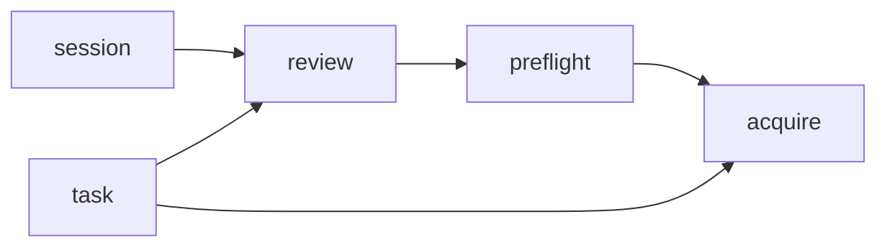

# Get started

Write a workflow, run it, answer it from a browser, and find what it recorded.

## Install

```bash
uv init my-experiments && cd my-experiments
uv add "aind-clabe[frontend]"   # the terminal UI and the web UI (without it: plain console prompts)
git init && git add -A && git commit -m "start"   # every run records the commit it used
```

## Write a workflow

A workflow is a list of steps. **A step's name is the name of its output, and its parameters are the outputs it
needs.**

```python
# main.py
from pydantic import BaseModel

from clabe import checks, steps, ui
from clabe.workflow import Workflow


class Task(BaseModel):
    trials: int = 100
    reward_ul: float = 3.0


wf = Workflow("hello")
wf.step(steps.session(experimenter_validator=None))  # who is running, on which animal


@wf.step
def task() -> Task:
    return ui.form(Task, title="Task")  # a form from the model


wf.step(steps.review("session", "task"))  # one table; "Go back" re-asks
wf.step(steps.preflight(checks.free_space(1e9)))  # fails listing every problem


@wf.step(title="Acquire")
def acquire(task: Task) -> None:  # takes `task`'s output
    ui.notify(f"Running {task.trials} trials")
```



## Run it

```bash
uv run clabe run --allow-dirty   # runs main.py
```

The terminal shows the prompts, and so does the address it prints. Answer in either: the first valid answer wins.

- **Go back** re-runs a step and only the steps that depend on it.
- A step that raises pauses the run with **Retry / Go back / Abort**.

## Find the records

```text
<data folder>/<session>/Behavior/Logs/.launcher/
  events.jsonl     every prompt, answer and step
  outputs.jsonl    every output, with the inputs it came from
  run.json         code, environment, machine, outcome
```

```bash
uv run clabe replay <that folder>/events.jsonl main.py --allow-dirty   # run again with the same answers
uv run clabe check main.py --strict                                     # check the wiring in CI, without running
uv run clabe shortcut --name "Hello"                                    # a desktop icon that runs it
```

## Next

- [Workflows](learn/workflows.md): step options, conditions, branches, variants.
- [Prompts & frontends](learn/prompts.md): everything `ui` can ask, and where it shows.
- [A complete AIND experiment](docs_examples/behavior_launcher.md).
