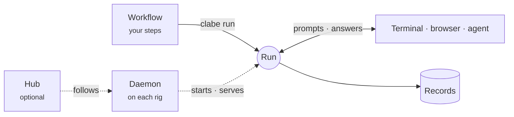

---
hide:
  - navigation
---

<div class="clabe-hero" markdown>

# clabe<span class="clabe-slash">/</span>

<p class="lead">Write a behavior session as Python steps. The rig runs it, anyone can answer its prompts from the terminal, a browser or an agent, and everything is recorded.</p>

[Get started](get-started.md){ .md-button .md-button--primary }
[Set up a rig](rigs/set-up.md){ .md-button }
[GitHub](https://github.com/AllenNeuralDynamics/clabe){ .md-button }

</div>



```python
# main.py
from clabe import steps, ui
from clabe.workflow import Workflow

wf = Workflow("vr-foraging")
wf.step(steps.session())  # who is running, on which animal


@wf.step
def trials() -> float:
    return ui.number("Trials", minimum=1, maximum=500)  # validated by the run, whoever answers


wf.step(steps.review("session", "trials"))
wf.step(steps.register())  # creates the session folder
```

```bash
uv add "aind-clabe[frontend]"
uv run clabe run            # the terminal UI here; the same prompts at the printed address
```

<div class="grid cards" markdown>

-   **[Get started](get-started.md)**: a workflow, run and answered, in ten minutes.
-   **[Workflows](learn/workflows.md)**: steps, going back, branches, variants.
-   **[Prompts & frontends](learn/prompts.md)**: asking the user, from any client.
-   **[Rigs](rigs/set-up.md)**: the daemon on each PC, two-PC sessions, the hub.

</div>
