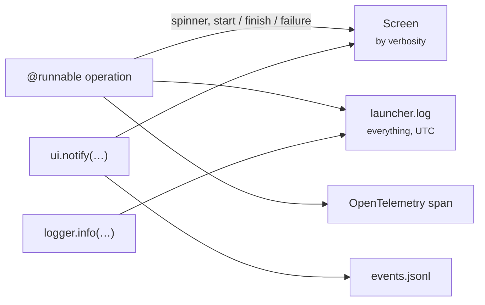

# Apps, runnables and logging

How the operations a step runs report to the user and to the record.



## Runnables

```python
from clabe.runnable import runnable


class ValveCalibration:
    @runnable(name="Valve calibration")
    def run(self) -> float: ...
```

[`runnable`][clabe.runnable.runnable] adds a spinner, start / finish / failure messages, log lines and a span. Values
and exceptions pass through. It works on sync and async functions and methods.

| Option | Default | Effect |
|---|---|---|
| `name` | the class or function | Shown name |
| `notify` | `"<name>…"` | The start message |
| `notify_start`, `notify_success`, `notify_fail` | `True` | Which messages to show |
| `show_activity` | `True` | The spinner |

- Wrap at the call site for one call: `runnable(monitor.run, notify_success=False)()`.
- Only the outermost of nested runnables shows a spinner; tasks started with `asyncio.gather` each get their own.
- An overriding method is not wrapped: decorate it again.

## Logging

```python
import logging

logger = logging.getLogger(__name__)
logger.info("Starting transfer to %s", destination)  # %-style: never formatted when filtered out
```

| Flag | Screen shows | `launcher.log` keeps |
|---|---|---|
| `--quiet` | errors | info |
| *(default)* | warnings | info |
| `--verbose` | info | info |
| `--debug-mode` | debug | debug |

- Use a named logger, not `print()`. `exc_info=True` adds a traceback to the file.
- Tell the user with `ui.notify(...)`, or by raising an exception whose message says what to do; not both.
- After a run, the log is in the session: `Behavior/Logs/.launcher/launcher.log`.
