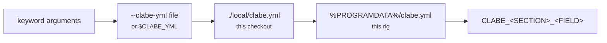
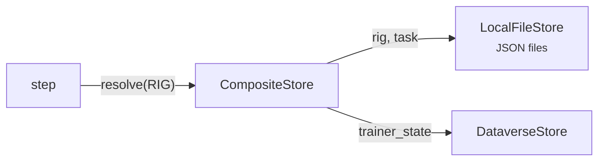

# Configuration and stores

Experiments read their settings from `clabe.yml`, and the records they run against (rigs, tasks, trainer state)
from stores.

## clabe.yml

Each service reads one section, through a [`ServiceSettings`][clabe.settings.ServiceSettings] subclass:

```python
class MyServiceSettings(ServiceSettings):
    __yml_section__: ClassVar[str] = "my_service"

    host: str = "localhost"
    port: int = 8080
```

```yaml
my_service:
  host: my-host
```

Fields merge across sources, the first one wins:



- Commit no `clabe.yml`: rig settings go in `%PROGRAMDATA%`, per-checkout ones in `local/`.
- Settings are read when a settings object is built.
- From code: [`set_clabe_yml`][clabe.settings.set_clabe_yml] installs a document (e.g. fetched from a config server)
  before anything reads it; [`override_clabe_yml`][clabe.settings.override_clabe_yml] replaces it inside a `with`
  block, for tests.
- Only experiments read `clabe.yml`. The daemon reads `DAEMON_CLABE_*` variables, the hub its `.env`.

Every section clabe ships is in [Settings](../reference/settings.md).

## Stores

A store reads and writes an experiment's records. A [`Kind`][clabe.stores.Kind] names a record and the model it
parses to.

```python
from clabe.stores import CompositeStore, Kind, LocalFileStore
from clabe.aind.dataverse import DataverseStore

RIG = Kind.from_rig(MyRigModel)
SUGGESTION = Kind.from_trainer_state()

store = CompositeStore(
    default=LocalFileStore(root=r"\\allen\aind\scratch\AindBehavior.db\MyProject"),
    routes={"trainer_state": DataverseStore()},
).scoped(subject=session.subject)

rig = store.resolve(RIG)  # asks the user when there is a choice
store.write(SUGGESTION, trainer_state)
```



| Method | Does |
|---|---|
| `resolve(kind)` | The one record to use now; asks the user when there are several |
| `list(kind)` | Every record in scope, never asks |
| `write(kind, value)` | Saves a record |
| `scoped(**scope)` | A copy narrowed, e.g. to one animal |

Use the `Kind.from_rig` / `from_task` / `from_trainer_state` constructors for framework records: `Kind(MyRigModel)`
would be named `my_rig_model`. Each backend, its layout, and how to write your own are in
[Stores](../reference/stores.md).
