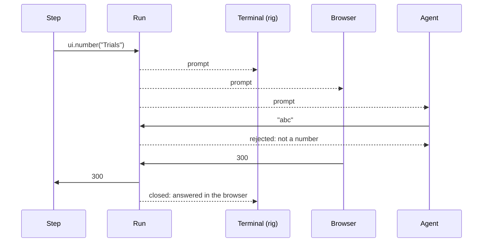
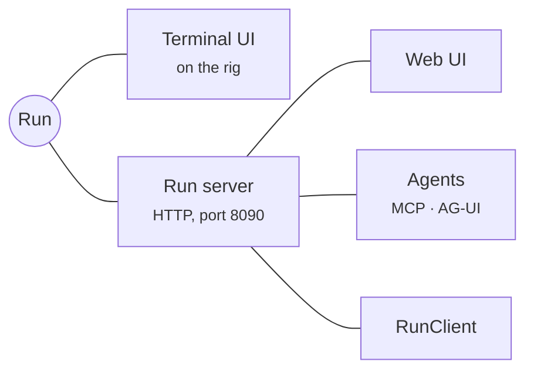

# Prompts and frontends

Steps talk to the user with `clabe.ui`. The same call shows in the terminal, in the browser and to agents, all at
once.

## How a prompt is answered



Every client sees every prompt. The run validates each answer against the prompt and accepts the first valid one,
so a step always gets a typed value.

## Ask the user

```python
from clabe import ui

ui.notify("Transferring data…")
if ui.confirm("Start the session?", default=True):
    rig = ui.pick("Choose a rig:", ["rig-1", "rig-2"], allow_none=False)
    trials = ui.number("Trials", default=200, minimum=1)
    config = ui.form(SessionConfig)  # a pydantic model, field by field
```

| Call | Asks for |
|---|---|
| `ui.text`, `ui.number`, `ui.confirm`, `ui.path` | One value |
| `ui.pick(options)`, `ui.autocomplete(options=fn)` | One of several; options may come from a function, called as the user types |
| `ui.form(Model)`, `ui.field(Model, "name")` | A pydantic model, or one of its fields, with its constraints |
| `ui.group(title, **requests)` | Several values on one screen |
| `ui.markdown`, `ui.image`, `ui.html`, `ui.url`, `ui.table` | Nothing: shows it and waits. `ui.html` takes a file or the HTML itself; the terminal opens HTML and URLs in the browser, and shows images in the web UI only |
| `ui.notify`, `ui.header` | Nothing: a message |

- After **Go back**, a prompt answered before opens with that answer; **Forward** submits it again.
- `SecretStr` fields are masked in the records.
- When going back or another client cancels the prompt, `ui.ask` raises
  [`PromptCancelledError`][clabe.ui.PromptCancelledError]: return or raise, do not ask again.
- Outside a run nothing can ask: helpers raise [`NoSessionError`][clabe.ui.NoSessionError] and `notify` logs. In
  tests, `with ui.bind(ClientSession(fake_client)):`.

## Frontends



```bash
clabe run                       # auto: the terminal UI in a terminal, plain console otherwise
clabe run --frontend headless   # no screen here: answer from the browser
clabe run --no-serve            # this terminal only
```

- The terminal UI and the web UI need the `frontend` extra. They share keyboard shortcuts; press `?` in the browser.
- A run is served on localhost. To reach it from elsewhere use `ssh -L 8090:localhost:8090 <rig>`, or `--host
  0.0.0.0 --token …`. On a rig, the [daemon](../rigs/set-up.md) serves it for you.
- Both show what the run is about: workflow, subject, experimenters, rig.

The [run server reference](../reference/run-server.md) lists the API, the shortcuts, and how to write your own
client. [Agents](../rigs/agents.md) covers MCP and AG-UI.

!!! tip "Export logs, report an issue"
    Both are on every closing screen and in the browser's menu. **Export logs** downloads the run's records and logs
    as one zip. **Report an issue** saves the same zip on the rig with your comment, for the [hub](../rigs/hub.md) to
    collect (`F3` in the terminal UI).
