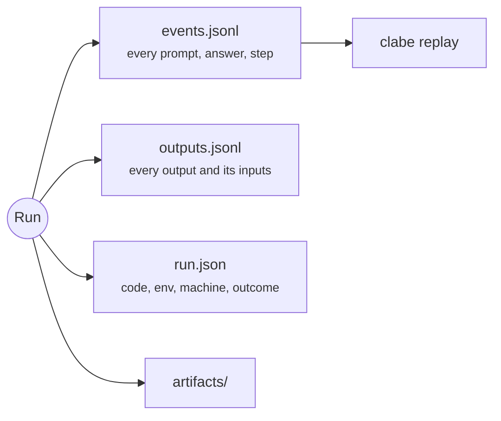

# Records and replay

Every run records what happened, enough to understand a session later or run it again.



They are in the session folder, under `Behavior/Logs/.launcher/`:

| File | Contents |
|---|---|
| `run.json` | Code (commit, diff), environment, machine, configuration and outcome. Written at the start, completed at the end |
| `events.jsonl` | One JSON event per line: prompts, answers, steps, app commands (with their UTC times), store records used |
| `outputs.jsonl` | One line per step attempt: the output, and which attempt of each input it used |
| `artifacts/<step>/<attempt>/` | Files steps exported |
| `repository.diff`, `uv.lock`, `launcher.log` | Uncommitted changes, the lockfile, the diagnostic log |

Secrets stay out: credentials in URLs are stripped, values that look like a token, key or password are masked, and
only `CLABE_*` and `OTEL_*` environment variables are kept.

## Replay

```bash
clabe replay <session>/Behavior/Logs/.launcher/events.jsonl main.py --allow-dirty
```

The experiment runs again, headless, with the recorded answers, and stops at the first prompt that differs. Secrets
cannot be replayed. In a test: `LocalClient(run, ReplayClient("events.jsonl")).drive()`.

## How outputs are recorded { #how-outputs-are-recorded }

```python
from clabe.workflow import codecs


@wf.step(codec=codecs.omit)  # lineage only: credentials, huge objects
def credentials() -> Credentials: ...


@wf.step(codec=lambda frames: {"n": len(frames)})  # your own summary
def frames() -> list[Frame]: ...
```

The default records pydantic models as JSON and other values through pydantic. A codec that raises falls back to
`repr`, marked `lossy`; the step does not fail.

## Artifacts

```python
from clabe.workflow import export_artifact


@wf.step
def configure(rig: Rig) -> Path:
    path = write_bonsai_config(rig)
    export_artifact(path)  # a copy, under artifacts/configure/<attempt>/
    export_artifact(rig, "rig.json")  # a model, as JSON
    return path
```

For small provenance files, not session data. It works inside a running step (its tasks and `asyncio.to_thread`
calls included), not from a new `threading.Thread`.

## Reading them

```python
from clabe.workflow.events import EventLog, PromptClosed

for event in EventLog.read(logs / "events.jsonl"):
    if isinstance(event, PromptClosed):
        print(event.answered_by, event.answer)
```
