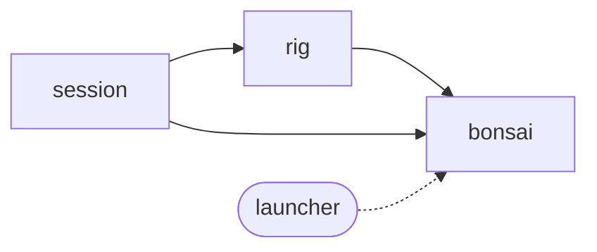
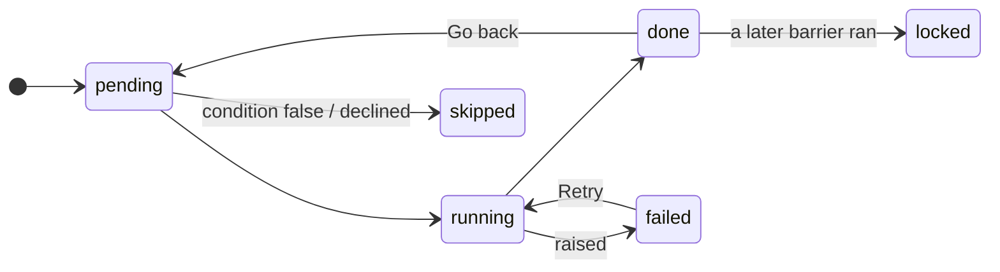
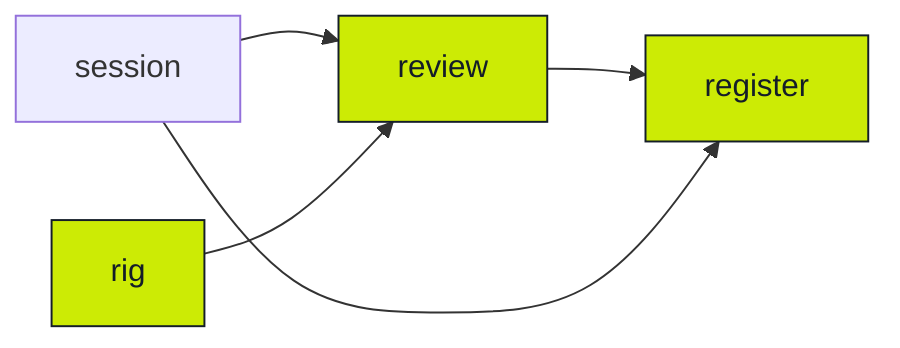
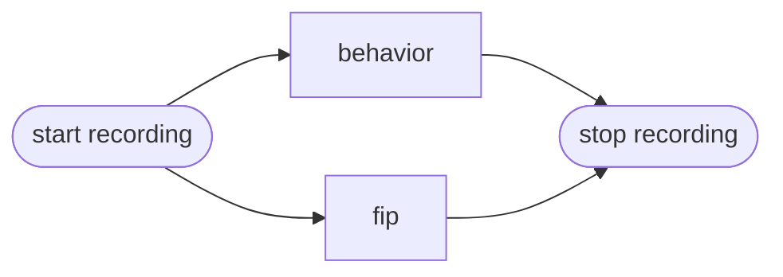

# Workflows

A [`Workflow`][clabe.workflow.Workflow] is an ordered list of steps. clabe runs them, shows them in every client,
and lets the user go back, retry or skip.

## Steps are wired by name

```python
from clabe import steps
from clabe.launcher import Launcher
from clabe.workflow import Workflow

wf = Workflow("vr-foraging", description="Patch foraging in VR.")
wf.step(steps.session())


@wf.step
def rig(session: Session) -> MyRig:  # takes the `session` step's output
    return load_rig(session)


@wf.step(title="Run Bonsai", barrier=True)
async def bonsai(launcher: Launcher, session: Session, rig: MyRig) -> None: ...
```



- A step's output is stored under its name. Its parameters name earlier outputs, or the built-ins `launcher` and
  `run`.
- Wiring mistakes (an unknown name, a duplicate) fail at import; `clabe check --strict` also checks annotations.
- Return new values (`session.model_copy(update=...)`) rather than mutating inputs.

## A step's life



**Go back** re-runs a step and only what depends on it. Going back to `rig` here re-runs the highlighted steps:



Users go back from any client; code can `raise GoBack("session")`.

## Step options { #step-options }

```python
@wf.step(optional="Generate a QC report?", on_error="warn")
def qc(launcher: Launcher) -> QcReport: ...
```

| Option | Effect |
|---|---|
| `title=` | The label clients show |
| `barrier=True` | Once it ran, neither it nor anything before it can run again |
| `optional="…?"` | Asks first; declined outputs `None` (`optional_default=False` suggests "no") |
| `when=` | Runs only when a condition on earlier outputs holds ([below](#conditions)) |
| `on_error="warn"` | A failure warns and continues with `None`, instead of Retry / Go back / Abort |
| `on_failure=` | Which choices a failure offers (`OnFailure.RETRY`, `OnFailure.ABORT`; default all) |
| `cancellable=True` | Going back may interrupt the busy async step |
| `undo=` | Called with the output when going back invalidates it |
| `codec=` | How the output is recorded ([Records](records.md#how-outputs-are-recorded)) |
| `name=` | Store the output under another name |

## Conditions { #conditions }

```python
@wf.step
def mode() -> str:
    return ui.pick("Calibration", ["measure", "reuse"], allow_none=False)


@wf.step(when=lambda mode: mode == "measure")
def calibrate(rig: MyRig) -> Calibration: ...


@wf.step
def acquire(calibrate: Calibration | None) -> None: ...  # None when skipped
```

- `when` takes earlier outputs by name and must be a plain (not async) function.
- Steps that receive a skipped output annotate it `T | None`; `clabe check` reports those that do not. Steps sharing
  the same `when` never receive `None` from each other.
- Going back to `mode` evaluates the conditions again. When two cases differ only in code, an `if` is simpler.

## Branches

[`concurrently`][clabe.workflow.concurrently] runs several apps at once inside one step. Wrap them in `async with`
for something that must last as long as all of them, such as a recording:

```python
@wf.step(title="Acquire", cancellable=True)
async def acquire(rig: MyRig) -> dict:
    async with ephys_recording():  # starts first, stops after the last branch, also on failure or abort
        return await concurrently(behavior=run_bonsai, fip=run_fip)  # {"behavior": ..., "fip": ...}
```



A failed branch offers **Retry**, **Continue without** (its result is `None`) or **Stop all**. A cancelled branch
has 30 s to run its `finally`.

## Variants and shared blocks

```python
fip = wf.variant("vr-foraging-fip").insert_after("rig", fip_rig).replace("qc", my_qc)
recovery = wf.variant("recovery", order=10).remove("qc")

experiment = wf.concatenate(handoff)  # a shared workflow's steps appended (e.g. the data hand-off)
```

- `variant` copies the workflow; `remove` refuses a step a later one takes.
- A concatenated block shares only the built-ins: its steps read what they need from `launcher` (e.g.
  `launcher.session_directory`).
- A file can declare several workflows; `clabe run --experiment-name <name>` picks one.

## When the run ends

Every client shows a closing screen (outcome, session folder, **Export logs**, **Report an issue**).
`exit_prompt_timeout` decides when the run exits:

| `Workflow(exit_prompt_timeout=…)` | The run exits |
|---|---|
| `None` (default) | When a client closes it |
| `0` | At once |
| `N` | After an `N` s countdown |

A run that failed with an error waits until someone has seen it: Enter in the terminal, or, headless, until no
browser has had it open for `N` s.
