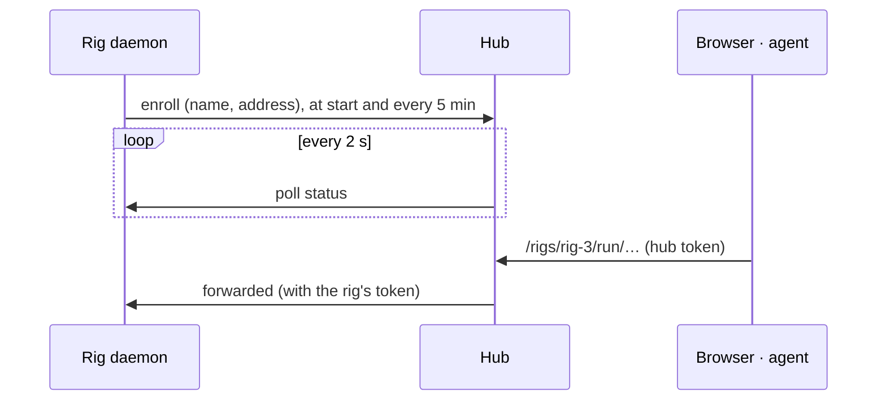

# The hub

An optional page for the whole fleet: every rig's status, every run waiting for an answer, live sessions and issue
reports, at one address and behind one token.



The hub keeps no list of rigs: each rig enrolls itself, and the hub then follows it like any client. Each rig is
served under `/rigs/<id>/` (page, run, APIs), so the web UI, [`RunClient`][clabe.server.RunClient] and
[agents](agents.md) work across the fleet.

## Run the hub

```bash
cp docker/hub/.env.example docker/hub/.env      # set TOKEN: the hub can drive every rig it follows
docker compose -f docker/hub/compose.yml pull
docker compose -f docker/hub/compose.yml up -d
```

It runs the image `HUB_TAG` names in `.env`: `main` (the default), `sha-<commit>` for any commit of main, or a release
(`v0.18.0`). `up -d --build` builds this checkout instead.

Then point rigs at it: `DAEMON_CLABE_HUBS=https://hub-vm/clabe` (or `clabe daemon deploy --hubs …`). Every setting
is in the [hub reference](../reference/hub.md).

## Manage rigs

- **Moves are confirmed.** A known rig enrolling from another address shows **moved** and is not polled, nor sent
  its token, until someone clicks **Confirm move**. No machine can take over a rig's name.
- **Tokens.** A rig with a `DAEMON_CLABE_TOKEN` needs it from the hub too: enter it once with **Token** on its card.
  People then need only the hub's token. Tokens are never shown back.
- **Remove** a rig with the bin on its card; it comes back if it enrolls again. **Exclude** keeps rigs out by
  pattern (`BEH.*`, `rig-3`), under **Rigs ▸ Excluded**.
- **Restart** a rig's daemon with the button on its card: through the daemon's API, or, when it does not answer,
  over SSH with a rig account typed on the card (used for that connection only, never stored). A run in progress is
  stopped. The hub remembers each rig's SSH host key and refuses a rig that shows another one.

## Issue reports

The hub collects every report filed on a rig, stores it, and only then deletes it from the rig. Reports live in the
hub's data volume (`hub.db` and one zip each); each has a link to share (**Copy link**).

!!! tip "Theme and time zone"
    **Settings** (or the gear in the top bar) sets the theme and whether times show in local time or UTC, for every
    clabe page in that browser. Times are stored in UTC everywhere. On a rig's page the gear opens the
    same settings; on the run page they are under **View**.
