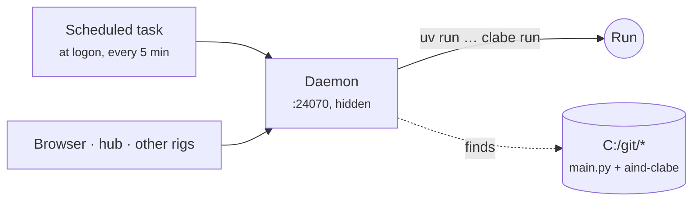

# Set up a rig

Every rig PC runs the clabe **daemon**: it lists the PC's experiments, starts them, and serves the run in progress
at one address, for browsers, the hub and other rigs.



| Address | Shows |
|---|---|
| `http://<rig>:24070/` | The PC and its experiments: start one from here |
| `http://<rig>:24070/run/` | The run in progress |

## Install

You need a Windows user that stays logged on (the daemon runs in its desktop session), the experiment repositories
cloned under `C:/git`, and port 24070 reachable. As that user:

```powershell
powershell -ExecutionPolicy ByPass -c "irm https://raw.githubusercontent.com/AllenNeuralDynamics/clabe/main/scripts/install.ps1 | iex"
```

It installs uv if needed, the `clabe` command, and the daemon with its scheduled task. Running it again updates or
repairs. **Pin the version on rigs** (`-Version 0.18.0`); every parameter is in the
[daemon reference](../reference/daemon.md#installer).

- The daemon needs no settings beyond an optional token (`DAEMON_CLABE_TOKEN`). Experiments read the rig's
  `%PROGRAMDATA%\clabe.yml` (the installer's `-Config` writes it).
- A repository is any folder right under `C:/git` with a `main.py` and a `pyproject.toml` depending on `aind-clabe`.
  Its experiments run in its own locked environment.

To change it later, deploy the one you want. It installs beside the running one, and a failed install leaves the
daemon as it was. Deploy refuses during a session unless `--force`.

```powershell
clabe daemon deploy --lock C:/git/Aind.Experiment.X   # the clabe that repository locks
clabe daemon deploy --version 0.18.1                  # a release, newer or older
clabe daemon deploy --commit 82d2107                  # a commit of clabe's main branch
```

!!! tip "Use a commit without a release"
    Every commit pushed to clabe's main branch has a build (web UI included) in the
    [builds release](https://github.com/AllenNeuralDynamics/clabe/releases/tag/builds). Pin an experiment to one with
    its wheel's URL, then deploy with `--lock`:

    ```toml
    [tool.uv.sources]
    aind-clabe = { url = "https://github.com/AllenNeuralDynamics/clabe/releases/download/builds/aind_clabe-<version>+g<commit>-py3-none-any.whl" }
    ```

    A `git+https://…` pin installs clabe without its web UI.

Over SSH, pipe the rig's `clabe.yml` to the installer:

```bash
ssh rig-3 'powershell -NoProfile -ExecutionPolicy ByPass -c "& ([scriptblock]::Create((irm https://raw.githubusercontent.com/AllenNeuralDynamics/clabe/main/scripts/install.ps1))) -Version 0.18.0 -Config -"' < clabe.yml
ssh rig-3 clabe daemon status      # idle, busy or leased
ssh rig-3 clabe daemon restart     # refused during a session; --force interrupts it
```

!!! warning "Never start it with `clabe daemon run` over SSH"
    It could not show windows and would stop with the SSH session.

!!! info "The daemon restarts itself"
    If it is not running, its task starts it within 5 minutes. If it does not answer for 2 minutes, it ends itself
    and the task starts it again. Only `clabe daemon stop` keeps it down, until `start`, `restart` or `deploy`. The
    [hub](hub.md#manage-rigs) can restart it too.

## Run an experiment

- **From a browser** (the daemon's page, or the hub): the run starts headless and is answered in the browser.
  **Show on the rig** also opens the terminal UI or the browser on the rig's screen. One run at a time.
- **From the rig**: a desktop icon runs an experiment in a terminal. The daemon hosts the run, so the hub and
  browsers see it too. Closing the window stops the run.

```bash
uv run clabe shortcut --experiment-name vr-foraging --name "VR Foraging"   # in the repository
```

!!! info "If the window dies"
    A terminal ended from the Task Manager leaves the run going. The next click on the icon asks to **Resume** it or
    **Abort** it and start a new one. **Stop** (the page, the hub) asks the run to abort, and ends it after 30 s.

Neither the daemon nor the runs it starts open a window of their own. Windows the experiment opens, like Bonsai's,
show as usual. **Report an issue** saves a report on the rig until the hub collects it.
