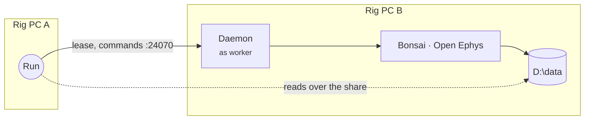

# Two PCs

Run an app on a second rig PC (ephys, FIP) from the session on the first, and upload both machines' data together.



The [two-PC example](../docs_examples/remote_execution.md) is the full script.

## 1. Prepare PC B

[Set up the daemon](set-up.md) on it and clone the same repository under `C:/git`: commands run in that checkout's
environment.

!!! warning "The daemon runs any command it is given"
    Keep it on the rig network. With a token, `DAEMON_CLABE_TOKEN` on B and `worker_client: token:` in the
    experiment's `clabe.yml` must match.

## 2. Connect

```python
wf.step(steps.remote(lambda ephys_rig: ephys_rig.computer_name))  # outputs `remote`, or None when it is this PC
```

The step reaches B's daemon (starting its task if needed) and checks B's checkout matches this one: same origin,
commit and submodules, nothing uncommitted (`allow_dirty=True` relaxes it). In code:
`RemoteRepository.from_computer_name("rig-b")`, then `ensure_running()` and `verify()`.

## 3. Run an app there

Pass `executor=remote` to any app:

```python
results = await concurrently(
    behavior=lambda: behavior_app.run_async(),
    fip=lambda: fip_app.run_async(executor=remote),  # runs on PC B
)
```

- The first command **leases** B: other runs get `423` until this run ends.
- Paths inside the repository are rewritten to B's checkout; the app's input files (rig, session JSON) are copied
  there and removed afterwards.
- Output streams into the run's UI. Aborting the run stops the command on B; `run.json` records each command.
- Without an app: `remote.client.run_command(["python", "--version"])`, or `submit_command` to poll later.

## 4. Its session folder

```python
remote.register_session(session, ephys_rig.data_directory)  # creates D:\data\<session> on B
```

| Property | Example | Use it on |
|---|---|---|
| `remote.session_directory` | `D:\data\<session>` | PC B: app settings, output folders |
| `remote.session_directory_unc` | `\\rig-b\data\<session>` | PC A: the watchdog, data mappers |

`remote.to_unc(path)` translates any of B's paths: from `data_roots` when given, else from the folders B shares,
else from its drive's admin share (which needs admin rights on B).

## 5. Upload both

```python
WatchdogDataTransferService(source=launcher.session_directories, settings=..., session=session).transfer()
```

`launcher.session_directories` lists this PC's session folder, then every PC registered in this run, so one
manifest covers both. Every source must be reachable by the watchdog's account. See
[Data transfer](../reference/data-transfer.md) for splitting uploads.

## After a crash

B's commands keep running when the session on A crashes. Reattach within the daemon's `lease_grace` (5 minutes),
with the crashed run's id from its `run.json`:

```python
remote = RemoteRepository.from_computer_name("rig-b")
for job in remote.reattach(crashed_run_id):
    result = remote.wait_for(job.job_id)
```

## Troubleshooting

| Symptom | Fix |
|---|---|
| `401` | `worker_client.token` differs from B's `DAEMON_CLABE_TOKEN` |
| `423 In use by …` | Another run holds the lease; it frees when that run ends |
| `404 No repository named …` | Clone it under `C:/git` on B, or list it in `DAEMON_CLABE_REPOSITORIES` |
| `ensure_running()` times out | Daemon not installed on B, its user not logged on, or remote scheduling blocked |
| `verify()` lists commits | Update B's checkout and `uv sync` |
| A path fails on PC A | Use `session_directory_unc` |
